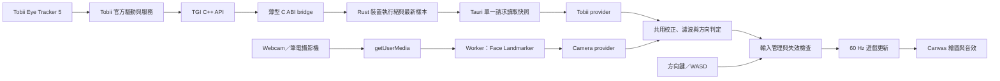
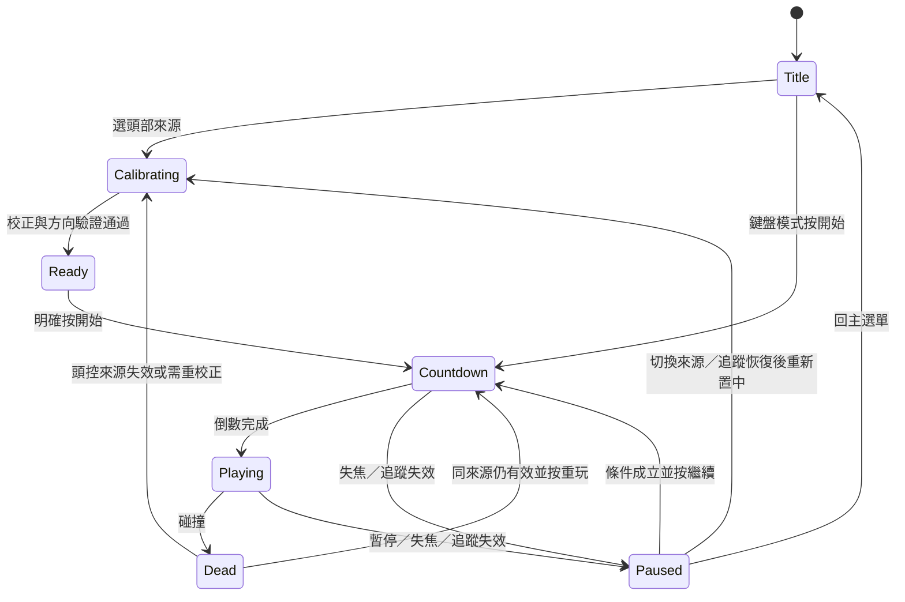

# FlyingMoo 桌面封裝與頭部追蹤 TRD

| 項目 | 內容 |
| --- | --- |
| 文件版本／日期 | 1.0／2026-10-21 |
| 對應需求 | [PRD.md](PRD.md) |
| 技術基線 | 原始 `flying-cow.html`；OcuTrain 現有 Tauri 2 工作目錄 |
| 評估範圍 | 原始碼與設定檔檢查、官方技術／授權資料查核、目標架構與驗收設計 |
| 尚未執行 | SDK 套件／實機驗證、桌面編譯、相機實測、效能量測及發行 |

本文件中的目錄、型別、指令與設定均為**待實作規格**，不代表目前專案已有這些檔案或功能。技術文件查核日期為 2026-10-21；SDK API、ABI、Runtime 下限及實際散布權利應在 M0 依取得的套件重新確認。

## 1. 建議架構與可行性結論

採用 Tauri 2 封裝既有網頁；遊戲繼續使用原生 JavaScript、Canvas 2D 與 WebAudio。Rust 只負責桌面能力及 Tobii；攝影機推論放在 Web Worker。



| 項目 | 評估 | 結論 |
| --- | --- | --- |
| HTML 封裝 EXE | OcuTrain 已有相同類型宿主可參考 | 高可行；仍須在 FlyingMoo 建立專案與發行驗證 |
| webcam 頭控 | Face Landmarker 提供臉部變換矩陣，可推得朝向 | 可行；Worker／WASM／離線資產需在打包後 WebView2 驗證 |
| ET5 頭控 | TGI 官方公開 head pose 取得方式 | 技術方向可行；正式 SDK、套件 ABI、樣本新鮮度與實機為必要前提 |
| 同一套四方向行為 | 現有遊戲已採方向布林值 | 共用 mapper 即可，無需 OS 鍵盤模擬 |
| 單檔且無任何外部前置條件 | WebView2 與 Tobii 驅動仍是外部元件 | 不作此承諾；以 PRD §8 的 portable 定義交付 |
| 直接複製 OcuTrain Tobii 串流 | 現有實作為 gaze point，不是 head pose | 不成立；只能參考生命週期與宿主邊界 |

TGI 提供頭部串流；官方範例使用 `GetLatestHeadPose()`，輸出 yaw／pitch／roll 度數。公開入門頁示例套件為 2022 年 8.0.0，**不據此宣稱它是目前最新版**。[TGI 入門文件](https://developer.tobii.com/pc-gaming/develop/tobii-game-integration/getting-started/)

## 2. 原始碼證據與參考邊界

### 2.1 FlyingMoo 基線

`flying-cow.html` 檢查時的 SHA-256：

```text
C5F8E001EBCB98FE22623A5A401DFD4EF035EA7687CD9C79CFDD4B0D90BA9735
```

| 位置 | 觀察 | 技術影響 |
| --- | --- | --- |
| `flying-cow.html:89` | `keyUp/keyDown/keyLeft/keyRight` | 可替換為單一方向快照 |
| `flying-cow.html:170` | `update(dt)` 同時做移動、生成、碰撞與得分 | 保留遊戲責任，不將裝置處理塞入 |
| `flying-cow.html:176` | `steer`、`climb` 由方向相減產生 | 自然支援相反鍵抵銷與兩軸操作 |
| `flying-cow.html:195` | `spawnTimer` 每次 update 減一 | 需要真正固定步長，才能讓頻率變化不影響生成 |
| `flying-cow.html:245` | 死亡時保存最佳成績 | 保留成績語意及既有 key |
| `flying-cow.html:623` | 程序式 WebAudio | 無需加入音檔依賴；需保留手勢啟用 |
| `flying-cow.html:732` | `onKey()` 直接改全域布林值 | 改由 held-key 集合與輸入管理器決定 |
| `flying-cow.html:764` | rAF 迴圈以 `min(STEP, rem)` 更新 | 註解稱 fixed-step，但仍會執行小於 STEP 的尾步 |

未找到既有套件設定、桌面宿主或測試基礎。原始遊戲無外部 JS／圖片／音檔請求；新增的模型與 WASM 必須維持離線執行。

### 2.2 OcuTrain 的實際做法

以下以使用者指定資料夾的檔案為依據，不以舊 `bin/`、`obj/` 中的 .NET 編譯殘留判斷目前架構：

參考專案 HEAD 為 `d8f099389942f8991fb4c6725bc8d9baf03e74a0`；本評估以實際讀到的工作目錄檔案為準。其 `Cargo.lock` 鎖定的 Tauri 版本為 2.12.4，這是參考專案版本，不代表 FlyingMoo 已選定發行版本。

| 檔案 | 已觀察內容 | 採用方式 |
| --- | --- | --- |
| `../OcuTrain/package.json` | Tauri CLI；`tauri build --no-bundle` 後執行 portable 腳本 | 沿用單一明確建置入口 |
| `../OcuTrain/src-tauri/tauri.conf.json` | `frontendDist: ../wwwroot`、HTTPS scheme、bundle 關閉 | 參考靜態資產內嵌及本機 origin |
| `../OcuTrain/src-tauri/Cargo.toml` | Tauri 2、serde、libloading；release strip／LTO | 參考小型宿主，不引入完整瀏覽器執行環境 |
| `../OcuTrain/src-tauri/src/main.rs` | 本機 main WebView 相機權限、Rust commands、退出清理 | 沿用責任分工，增加明確授權與來源檢查 |
| `../OcuTrain/src-tauri/src/tobii.rs` | `tobii_gaze_point_subscribe`、每筆 gaze 發事件、DLL 以 `include_bytes!` 內嵌後解出 | 僅參考原生生命週期與封裝；姿態 API 與傳輸策略重做 |
| `../OcuTrain/wwwroot/desktop.js` | 前端與 Tauri 事件／命令橋接 | FlyingMoo 保留單一 desktop adapter |
| `../OcuTrain/scripts/package-portable.cjs` | 複製 release EXE 至 `dist/`，附 LICENSE／README | 參考版本命名及附帶說明 |
| `../OcuTrain/.github/workflows/windows-portable.yml` | Windows 建置、測試、啟動檢查與 SHA-256 | 沿用驗證概念 |
| `../OcuTrain/package.json`、`../OcuTrain/LICENSE` | AGPL-3.0-only | 複製程式碼前確認義務；不整包複製 WebGazer／jsPsych |

OcuTrain 的 `csp: null`、全量 gaze 事件及研究資料輸出不適用本遊戲。FlyingMoo 應重新設定 CSP，並只讀取最新頭部姿態。

## 3. 技術選型與排除理由

### 3.1 桌面宿主

| 方案 | 優點 | 成本／限制 | 決策 |
| --- | --- | --- | --- |
| Tauri 2 + Rust + WebView2 | 與 OcuTrain 一致；靜態前端與原生橋接界線清楚；不另附 Chromium | 需要 Rust／MSVC 建置及系統 WebView2；相機／WASM 需驗證 | 主方案 |
| Electron | Node／Chromium 整合方便，執行環境較一致 | 發行包含另一套瀏覽器與 Node；偏離參考專案；Tobii 仍需原生橋接 | 不採用 |
| .NET + WebView2 | 適合熟悉 C# 的團隊；可用 TGI C# wrapper | 額外宿主技術；自含部署另帶執行環境；不是 OcuTrain 現有主線 | 備選，不雙軌維護 |
| PWA／一般瀏覽器 | 網頁部署容易 | 不直接提供要求的原生 EXE 與 TGI 橋接 | 僅作網頁預覽 |

選 Tauri 的理由是結構與部署方式符合本專案；啟動速度、CPU 與體積優勢仍須量測，不以框架名稱代替效能證據。

### 3.2 頭部追蹤

| 方案 | 適用性 | 決策 |
| --- | --- | --- |
| TGI head pose | 官方面向 PC 遊戲，提供 ET5 類消費型裝置的頭部資料 | Tobii 主方案 |
| Stream Engine head pose | 實際套件可能有對應串流，但符號存在不等於裝置支援或授權開通 | 僅在 TGI 不可取得、且官方確認 ET5／套件／權利後另評估；不預先實作第二條 Tobii 路徑 |
| OcuTrain 現有 gaze point | 提供螢幕注視座標，無法區分眼球移動與轉頭 | 不採用 |
| Tobii Pro SDK／Pro Lab | ET5 官方明示不相容 | 不採用；[官方 FAQ](https://gaming.tobii.com/product/eye-tracker-5/) |
| MediaPipe Face Landmarker | 從一般相機取得臉部變換矩陣，推論可在瀏覽器本機執行 | webcam 主方案；[官方 Web 文件](https://ai.google.dev/edge/mediapipe/solutions/vision/face_landmarker/web_js) |
| WebGazer | 主要估計螢幕注視點，需要不同校正與資料目的 | 不沿用；本需求不需要 gaze estimation |
| Python／OpenCV sidecar | 可處理頭姿，但新增 Python、模型與跨程序部署 | 本版不採用 |
| 第三方頭控轉鍵盤軟體／SendInput | 容易做原型，但有全域按鍵、卡鍵、焦點與外部安裝問題；遊戲已能直接吃方向狀態 | 不採用 |

Tobii 與 webcam 是替代輸入來源，不融合、不平均，也不拿 Tobii 資料訓練或比較競品追蹤模型。SDK 範圍以取得的合約為準。

## 4. 程式碼結構與責任

### 4.1 建議目錄

```text
FlyingMoo/
  PRD.md
  TRD.md
  flying-cow.html                原始基線，初期保留供對照
  package.json
  package-lock.json
  README.md
  THIRD_PARTY_NOTICES.md
  wwwroot/
    index.html                  DOM 選單、設定、校正、Canvas
    styles.css
    app.mjs                     畫面流程與來源生命週期協調
    game.mjs                    原有 update／render／音效，保留為一個遊戲模組
    input.mjs                   held keys、按軸接管、重設與方向快照
    head-control.mjs            中立校正、濾波、遲滯、方向確認
    desktop.mjs                 唯一 Tauri adapter 與原生時鐘映射
    providers/
      webcam.mjs                相機請求、幀排程與 Worker 溝通
      pose-worker.mjs           Face Landmarker 初始化與推論
      tobii.mjs                 快照輪詢、狀態轉換與姿態正規化
    vendor/mediapipe/            固定版本 JS 與匹配的 WASM 檔
    models/face_landmarker.task  固定模型及來源／雜湊清單
  src-tauri/
    Cargo.toml
    Cargo.lock
    build.rs
    tauri.conf.json
    capabilities/main.json
    src/main.rs                 視窗、指令邊界、相機權限及退出清理
    src/tobii.rs                SDK 執行緒、最新快照、載入與停止
    native/tgi_bridge.h
    native/tgi_bridge.cpp       唯一接觸 TGI C++ 物件的薄型橋接
  scripts/
    prepare-assets.cjs          依固定清單複製第三方執行資產
    package-portable.cjs        檢查產物、命名、SHA-256、附帶聲明
  tests/
    input.test.mjs
    head-control.test.mjs
    game.test.mjs
    fixtures/                   合成姿態／矩陣／時間序列
  dist/                         建置產物，不作為原始碼
```

不加入 React、狀態管理框架、遊戲引擎、通用 plugin registry、HTTP／WebSocket 服務或資料庫。前端維持 ESM；上述檔案依責任拆分，不把每個繪圖函式再拆成獨立模組。模型與 vendor 資產由建置腳本處理，不用腳本改寫遊戲原始碼。

### 4.2 依賴方向

- `game` 只讀取方向快照及執行狀態，不讀相機、Tauri、Tobii、DOM 設定或姿態。
- `input` 整合鍵盤與頭控方向，保證相反方向不會同時生效。
- `head-control` 只接受標準化姿態與時間；所有演算法可純函式測試。
- provider 只負責取得與轉換姿態，不能直接改 `cowX/cowY`、開始或重玩。
- `app` 管理選單、校正、暫停、來源切換及錯誤。
- `desktop` 是唯一知道 `window.__TAURI__` 的前端檔案。一般瀏覽器可預覽鍵盤／webcam；Tobii 選項在沒有宿主時明確停用。
- Rust 不包含遊戲規則，C++ 不包含 UI 或方向門檻。

網頁版透過 localhost 或 HTTPS 開啟；拆模組後不承諾直接雙擊 `file://` 仍能完成 Worker、模型載入與相機權限。

### 4.3 最小介面

以下使用型別記法描述合約，實作可用 JavaScript + JSDoc，無需因此改用 TypeScript：

```ts
type Source = 'tobii' | 'webcam';
type Directions = { up: boolean; down: boolean; left: boolean; right: boolean };

type PoseSample = {
  source: Source;
  sessionId: number;
  sequence: number;
  capturedAtMs: number; // 進入共用層前已映射至前端 performance.now() 時鐘
  yawDeg: number;       // 向使用者右方轉頭為正
  pitchDeg: number;     // 抬頭為正
  rollDeg: number;      // 只供轉換驗證，第一版不直接控制
};

type ProviderMessage =
  | { type: 'pose'; sample: PoseSample }
  | { type: 'status'; sessionId: number;
      state: 'starting' | 'connected' | 'tracking-lost' | 'error' | 'stopped';
      code?: string };

interface HeadProvider {
  start(sessionId: number, onMessage: (m: ProviderMessage) => void): Promise<void>;
  stop(): Promise<void>;
}
```

無效資料用狀態訊息表達，不產生一筆「角度全為零」的假有效樣本。`sequence` 只在新感測樣本／新相機幀時前進，不因讀取快照而增加。共同層拒絕非有限數字、錯誤 session、倒序 sequence、重複／倒退時間，以及時鐘允許誤差之外的未來時間。

## 5. 狀態與來源生命週期

### 5.1 狀態分工

遊戲狀態為 `title | play | paused | dead`；追蹤流程為 `off | connecting | calibrating | ready | tracking-lost | error`。兩者分開，避免把「來源連線」寫進遊戲碰撞與繪圖。



主動暫停後，同一來源回正穩定 500 ms 可繼續；追蹤失效、相機變更、視窗跨螢幕後裝置位置改變或休眠恢復時，先重做中立校正。換來源或玩家則重做完整四方向驗證。每次繼續或重玩有 3 秒倒數；倒數不累積遊戲時間，失效時取消。

### 5.2 切換的唯一流程

1. 將遊戲設為 paused，清空 held keys、頭控方向、確認計時、濾波與待處理幀。
2. 遞增 `sessionId`，使舊 callback、Worker 結果及 IPC 回傳全部失效。
3. `await oldProvider.stop()`；清掉相機軌、Worker、輪詢與原生 SDK 連線。
4. 啟動新來源；成功後進入校正，不立即恢復遊戲。
5. 校正／回正通過，由使用者明確繼續。

使用中的來源不自動退回其他裝置；畫面提供「改用鍵盤／攝影機」等操作。鍵盤接管某一軸不代表已切換來源，頭控故障仍會暫停，需要明確選鍵盤才能解除對頭控的依賴。

`start/stop` 必須可安全重複呼叫。使用者在相機權限對話框未結束時取消，之後才回傳的 MediaStream 必須立即停止所有 tracks，不能成為背景相機。

### 5.3 停止與錯誤

- `blur`、`visibilitychange`、宿主失焦／最小化與休眠恢復都執行集中 `pauseAndReset(reason)`。
- 確認的失效事件立即重設；收不到事件時，由遊戲每次更新自行檢查樣本年齡，不能只依賴 provider 的 timeout。
- `stop()` 正常應在 2 秒內完成。原生 SDK 關閉超時則標示 fault，禁止再建立第二個 TGI 連線，提示重新啟動後再用追蹤；仍可用鍵盤。
- 不在 Rust 中強制終止持鎖 SDK 執行緒。M0 必須證明 Update／Shutdown 能在可接受時間內返回。
- 正常錯誤可恢復；第三方 DLL 在同程序發生原生存取違規仍可能終止整個應用。第一版不增加隔離 sidecar，這是需透過 SDK 實測接受的限制。

### 5.4 錯誤碼與恢復動作

錯誤以穩定代碼跨層傳送，畫面使用對應的繁體中文說明；不將原生堆疊、路徑或 SDK 原始訊息直接當作玩家提示。

| 代碼 | 影響與畫面行為 | 恢復動作 |
| --- | --- | --- |
| `WEBVIEW2_MISSING` | WebView 尚未建立，由原生視窗說明缺少執行環境 | 安裝 README 指定的官方 Runtime 後重開 |
| `TOBII_RUNTIME_UNAVAILABLE` | Tobii 無法啟用；主選單與其他來源可用 | 檢查官方軟體／服務，重試或改來源 |
| `TOBII_DEVICE_ABSENT` | 無 ET5；遊戲中發生則清空並暫停 | 確認 USB／官方工具，恢復後重新置中 |
| `SDK_LOAD_FAILED` | DLL／相依元件缺失、損壞、版本或架構不符 | 重建程式快取或使用正確發行檔；可改來源 |
| `HEAD_POSE_UNAVAILABLE` | 裝置／SDK 不支援或未開通 head pose | 顯示能力不足，不退而使用 gaze 冒充；改用攝影機或鍵盤 |
| `CAMERA_PERMISSION_DENIED` | 相機流程停止，不反覆彈權限 | 指示 Windows／應用權限設定，再由玩家明確重試 |
| `CAMERA_NOT_FOUND`／`CAMERA_BUSY` | 沒有相機、被占用或無法開啟 | 接回裝置、關閉占用程式、改相機或鍵盤 |
| `MODEL_LOAD_FAILED`／`WORKER_FAILED` | 推論來源停止；遊戲中清空並暫停 | 重試初始化；檢查資產完整性或改來源 |
| `TRACKING_LOST`／`STALE_POSE` | 清空全部方向並暫停，不沿用最後樣本 | 回到有效位置、重新置中、明確繼續 |
| `SOURCE_STOP_TIMEOUT` | 不再建立第二個原生連線 | 顯示需重啟追蹤；可先改用鍵盤 |
| `STORAGE_UNAVAILABLE` | 保持可玩，提示設定／成績不會保存 | 使用本次 RAM 資料，不清除原成績 |
| `PERFORMANCE_DEGRADED` | 提示目前取樣／畫面不足，不自動修改世界時間 | 提供較低相機規格或改來源；改設定後重新驗證 |

## 6. 頭部資料正規化與控制演算法

### 6.1 座標與有效性

共用慣例：`yawDeg > 0` 為向使用者右方轉頭，`pitchDeg > 0` 為抬頭；畫面與相機是否鏡像不改變此定義。遊戲世界 `cowY` 正值是向上，Canvas 的 y 向下僅屬繪圖轉換。

每個 adapter 各自處理 SDK 的角度單位、軸方向、Euler 旋轉順序及矩陣儲存方式，輸出共同慣例。不得靠一次看起來正確的索引猜測矩陣為 row-major／column-major。

攝影機的 4×4 臉部變換矩陣須先取出 3×3 線性區塊、移除尺度並確認接近有效旋轉，再依固定版本的座標／旋轉順序解出角度；平移量不作方向控制。官方描述該矩陣把標準臉模型轉換到偵測到的臉；它不是直接輸出的 yaw／pitch，也不是相機內參已校正的臨床量測。[Face Landmarker Web 文件](https://ai.google.dev/edge/mediapipe/solutions/vision/face_landmarker/web_js)

矩陣解讀須用 identity、已知 ±yaw／±pitch／roll 與含尺度的合成 fixture 驗證，再用實機四方向確認。Tobii 依取得的正式 header／API 文件定義完成相同測試。

不要求所有 SDK 都提供數值 confidence。MediaPipe 的內部信心門檻可設定，但結果物件不保證回傳可直接共用的每幀分數；不能填入固定 0.99 當作品質。有效性至少需來源仍追蹤、數值與矩陣有效、樣本新鮮且屬目前 session。

### 6.2 校正

- 連續收集 2,000 ms 有效新樣本，至少 30 筆；任一樣本過期／明確無效則重開該次中立採集。
- 對角度先做 unwrap，再以中位數求 `yaw0/pitch0`；兩軸標準差各 ≤2° 才通過。此容許值於 PoC 確認。
- 10 秒未完成則停止本次採集並提供重試，不將最少幾筆資料強行當作成功。
- 四方向驗證要求目標方向維持 500 ms、其他軸中立，再回正 500 ms；順序為上、下、左、右。
- 中立姿態只存 RAM；同一來源重新置中後清掉舊濾波及方向記憶，不能沿用偏轉中的濾波輸出。
- 確認動作以角度相對中立的偏差為依據，不以鼻尖在影像中的位置位移作替代。

### 6.3 初始參數

| 參數 | 預設值 | 說明 |
| --- | --- | --- |
| yaw 啟動／釋放 | 12°／8° | 正向右、負向左 |
| pitch 啟動／釋放 | 10°／6° | 正向上、負向下 |
| 使用者可調啟動門檻 | 左、右各 4–25°；上、下各 4–20° | 四方向獨立，舊兩軸值對稱遷移 |
| 釋放門檻隨設定變更 | yaw 為啟動值 ×2/3；pitch ×0.6 | 保持大於零且嚴格小於啟動值 |
| One Euro Filter | minCutoff 3 Hz、beta 2、derivativeCutoff 1 Hz | yaw、pitch 獨立，輸入單位為度與採集時間；取代 EMA，保留遲滯 |
| 方向啟動／正常釋放確認 | 0 ms | 預設不再疊加確認等待；候選確認仍可由測試顯式設定 |
| 回正穩定 | 500 ms | 兩軸都在釋放區間內 |
| 接收時的樣本過期門檻 | 250 ms | 以採集時間檢查本筆姿態的年齡；超時結果不得使用 |
| 追蹤停流門檻 | 250 ms | 從最後一筆有效新姿態的接收時間計算；避免將推論耗時重複算入等待下一筆結果的期限。重複、過期及無效樣本不能延長期限 |
| webcam 目標推論率 | 30 Hz，最低驗收平均 20 Hz | 一次一幀，不排隊追趕 |
| TGI Update | 最多約 60 Hz | 是宿主輪詢上限，不是宣稱感測器 head pose 頻率 |
| 前端讀 TGI 快照 | 最多 30 Hz，單一 in-flight | 每次只拿最新值 |

門檻是候選設定，必須在 PRD 的參考機與兩種裝置上確認 NFR-02。產品設定保存來源各自的數字；不允許 NaN、Infinity、負值、釋放門檻 ≥啟動門檻或未識別版本的結構直接進入 mapper。

### 6.4 濾波與方向狀態

姿態處理固定順序：

1. 檢查 session、sequence、時間、來源與有限值。
2. 以 unwrap 後的角度求 `yaw - yaw0`、`pitch - pitch0`；確認左右／上下符號。
3. 以相鄰有效樣本的採集時間差做 One Euro Filter，依角速度調整截止頻率；置中、失效與暫停時重設角度與速度歷史。
4. 依正、負方向各自的啟動／釋放門檻做遲滯；預設不再額外等待候選確認。
5. 產生方向快照；遊戲只讀最後一份快照。

單軸狀態為 `negative | neutral | positive`：中立時到達正／負啟動門檻才提出候選；正向保持至低於正釋放門檻，負向保持至高於負釋放門檻。每次候選改變就重算確認時間；沒有新樣本不推進候選確認。從正跨到負時先釋放正向，再確認負向，同一時刻不能正負同時生效。

明確無效、過期、暫停與切換不等待濾波或候選確認，直接四方向 false。時鐘／序號回退表示需重建來源或重新同步，不把回退值當作新的中立姿態。

兩軸獨立，因此斜向輸出兩個方向；不做長度正規化，保留現有每軸 `MOVE_SPEED`，避免改變既有鍵盤斜向行為。頭部轉角只決定方向，不作類比速度。遊戲進行時，中立軸以相同速度回到可動平面的零點，抵達後停住、不越過中央；暫停時不執行回正。

### 6.5 鍵盤整合

用 `Set<KeyboardEvent.code>` 紀錄 held keys，而非 keyup 直接清掉方向：ArrowUp 與 KeyW 同時按下，放開其中一個仍保留另一個。處理 blur／pause 時清空整個集合。

每軸若有任一對應實體鍵被按住，使用該軸鍵盤值；否則使用頭部值。例如左右鍵都按住，水平值為 0 並壓過頭部水平；垂直軸仍可由頭部控制。鍵盤模式完全停止頭部來源。

Space／M／R／Esc 是單次操作，忽略 `event.repeat`。DOM 控制元件或選單正在處理鍵盤時，不觸發飛行與開始。避免用 `dispatchEvent(new KeyboardEvent(...))` 或 Windows `SendInput` 來串接頭控。

## 7. Tobii 原生路徑

### 7.1 前置條件與權利

先取得適用於 ET5 的正式 TGI SDK，保存版本、平台、header、執行 DLL、相依元件及散布條款。官方下載頁需申請與審核；沒有 SDK 套件時不能定稿 DLL 名稱、匯出符號或 C++ ABI。[官方申請頁](https://developer.tobii.com/software-downloads/)

ET5 需要官方驅動與 Tobii Experience／相關服務。本應用不內建驅動安裝，不以 WebUSB 或純網頁直接打開 ET5。[官方設定說明](https://help.tobii.com/hc/en-us/articles/360009325857-Installation-or-setup-issues-for-Tobii-Eye-Tracker-5)

M0 同時確認所取 SDK 的 VC++ Runtime 等相依元件。若不能合法且可靠地隨程式提供，就列入前置檢查與 README，不假設每台電腦已因安裝驅動而具備。

TGI 的開發／發行權利以實際核發合約為準。公開的舊版 limited SDLA 將 head pose／position 也納入 Eye Tracking Data，並區分即時互動與資料保存／分析；不能因只取頭部資料就預設可記錄或分析。[公開 SDLA 參考](https://developer.tobii.com/vr/sdla/)

### 7.2 為何使用 C ABI bridge

TGI 是 C++ 介面；Rust 不直接重建 C++ vtable、`bool`／參照布局或猜測虛擬函式 ABI。以一個薄型 C++ 靜態橋接庫連入 Rust，僅向 Rust 暴露自己的 C ABI 結構及狀態碼。

橋接介面責任：

| 操作 | 責任 |
| --- | --- |
| open | 接收主視窗 HWND 與固定 SDK 路徑，載入官方 SDK 並建立 API |
| update | 在擁有 SDK 的同一執行緒呼叫更新，不等待遊戲繪圖 |
| latest head pose | 複製最新 yaw／pitch／roll、來源樣本識別／時間與有效狀態；無新樣本有獨立回傳碼 |
| status | 區分未連線、無使用者、無 head pose、Runtime 缺失、SDK 不支援及一般錯誤 |
| close | 在同一擁有者執行緒 Shutdown 並釋放；不留下跨語言借用指標 |

橋接捕捉 C++ 例外並轉成錯誤碼，不跨 FFI unwind。固定欄位寬度、結構布局、calling convention、字串編碼、擁有權與有效期限，並有 Rust／C++ ABI 大小及 offset 檢查。

主方案採套件官方支援的動態載入方式，在使用 Tobii 時才載入 SDK；若該版本沒有此介面，M0 需用受控 delay-load 證明延遲載入可行。**不能讓 PE 啟動時強制載入缺失的 Tobii DLL，而導致鍵盤／攝影機版也打不開。** 載入細節在正式套件取得後鎖定，不另維護猜測版 SDK binding。

### 7.3 執行緒與資料傳送

- TGI 的 API、Update、讀取及 Shutdown 由同一專用執行緒擁有，依正式 SDK 規定綁定 main 視窗。
- 宿主最多約 60 Hz 更新，透過可喚醒等待避免 busy loop。裝置沒開啟時不啟動該執行緒。
- Rust 以短鎖保護一份最新快照，SDK 呼叫及 IPC 期間不持鎖。
- 前端以最多 30 Hz 讀取快照；上一個 `invoke` 未完成不再送下一個，不累積 request queue。
- 控制只使用最新有效姿態，不讀過期佇列；webcam 的逐筆 CSV 紀錄另走 Rust 背景批次寫檔，不阻塞控制與繪圖。
- 讀快照不改時間／序號；若 SDK 再次回傳同一筆 head pose，不當成新樣本。

官方裝置頁列出的影像／gaze 頻率不代表 head pose 實際輸出頻率。M0 必須量測有效新姿態率；禁止藉每 16 ms 重複舊值宣稱 60 Hz。

### 7.4 時鐘與新鮮度

不能直接相減 Rust `Instant`、SDK timestamp 與 JavaScript `performance.now()`。

1. Rust 建立應用層單調時鐘；SDK 若有獨立時鐘，依正式文件換算到 Rust 時鐘。
2. 開始來源時做 5 次 `get_native_clock` 往返，前端以發送／接收時間中點估計 offset，選最短 RTT 的結果，誤差界取 RTT/2。
3. Native 快照攜帶真正採集時間；adapter 加 offset 後輸出 `capturedAtMs`。定期約 30 秒重新同步；恢復前景／休眠後先重新同步並置中。
4. 以估計年齡的保守上界判定 250 ms 過期；時鐘估計不確定度 >25 ms 時先暫停並重新同步，避免偽裝為低延遲。
5. 若正式 SDK 無可映射的時間戳，必須有文件及實測證明的「新 head pose 樣本」通知／識別，才可用首次取得時間建立上界估計；其來源內部緩衝延遲也須納入 NFR-02。

若無法可靠區分新樣本與重讀舊值，Tobii 路徑不通過 M0。不能靠角度是否變化判斷新樣本，因為玩家可以保持不動。

### 7.5 最小原生指令

| 指令 | 輸入 | 輸出／約束 |
| --- | --- | --- |
| `start_tobii` | 目前 sessionId | 非阻塞啟動結果；Runtime 錯誤可顯示於前端 |
| `read_tobii_snapshot` | sessionId | 狀態及最新姿態／來源時間，沒有任意檔案參數 |
| `stop_tobii` | sessionId | 停止並釋放，不建立第二個連線 |
| `get_native_clock` | 無 | 單調時鐘值供 offset 估計 |
| `set_fullscreen` | boolean | 只作用於 main 視窗 |

所有指令在宿主端檢查 caller window、完整 origin、參數結構與當前 session；不只依賴前端按鈕或 Tauri capability。正式版本依鎖定 Tauri 版本配置 command ACL。

### 7.6 單檔中的原生元件

在授權允許的前提下，內嵌實際需要的 SDK DLL。啟用 Tobii 時解出至 `AppLocalData/FlyingMoo/native/<sdk-version>-<content-hash>/`，使用固定檔名清單、完整性檢查、暫存寫入後原子替換及版本目錄，避免覆蓋正在使用的 DLL。

以絕對路徑與安全 DLL 搜尋範圍載入；相依 DLL 同樣固定來源，不從目前工作目錄、可疑 PATH 或前端傳入路徑載入。首次解出失敗／快取損壞時顯示原生元件錯誤，其他操作來源仍可啟用。快取與 WebView2 資料均位於使用者帳號，不寫 EXE 旁的唯讀目錄。

## 8. 攝影機路徑與遊戲更新

### 8.1 相機取得

使用 `getUserMedia()`，明確設定 `audio: false`，video 先請求 640×480／30 fps 的 ideal constraints，顯示實際取得的設定。權限通過後列出可用相機，讓使用者選內建或外接裝置；相機選擇只保留於本次工作階段，不把 deviceId 當作可跨機器攜帶的永久識別。

只在使用者按啟用後請求權限。Tauri 使用 HTTPS 本機 scheme，實際預期為 `https://tauri.localhost`；宿主須解析並比對完整 origin 與 main 視窗，不以字串前綴或 host 子字串放行。相機請求亦須符合目前攝影機流程，麥克風維持拒絕／未授權。

主選單的普通進入不打開相機；已啟用的校正／遊戲／短暫暫停可維持預覽，回主選單、切來源或停用後停止 tracks。使用者不需錄影功能，也不使用 MediaRecorder。

相機存取遵守權限、裝置可用性與安全內容條件；處理拒絕、找不到裝置、裝置忙碌、條件不符合及 track ended 等情況。[W3C Media Capture and Streams](https://www.w3.org/TR/mediacapture-streams/)

### 8.2 MediaPipe 與 Worker

建議設定 `runningMode: 'VIDEO'`、`numFaces: 1`、`outputFacialTransformationMatrixes: true`、`outputFaceBlendshapes: false`。先用 0.5 的 detection／presence／tracking 內部門檻做 PoC，再依實測決定是否提高。第一版為單人使用；`numFaces: 1` 無法拿來保證偵測第二人或確認玩家身分。

`detectForVideo()` 是同步工作，官方建議以 Worker 避免阻塞 UI。本版不在遊戲 rAF 內直接推論。[官方執行說明](https://ai.google.dev/edge/mediapipe/solutions/vision/face_landmarker/web_js)

排程規則：

1. 優先用 `requestVideoFrameCallback` 偵測新幀；不支援時用 rAF 加 `video.currentTime` 去重。
2. 只有 Worker idle 且到達目標間隔才取一幀；最多一個取幀／推論工作在途。
3. 傳送可轉移的 ImageBitmap，附上 session、sequence 及主執行緒採集時間。若測試版本支援可靠的實際 capture 時間則採用；否則以取樣時間為估計並說明感測器內部延遲。
4. Worker 完成後只回傳角度／狀態與原時間，不把完成時間當作採集時間；主執行緒接收時再次檢查年齡。
5. 舊幀不補算；位圖在成功、錯誤、取消與舊 session 回傳時都釋放。初始化失敗、取幀失敗或 Worker crash 均可停止並重試。
6. 先驗證 CPU／WASM 在 Worker 運作；GPU delegate 只在已測 WebView2／Worker／OffscreenCanvas 組合下啟用。CPU 路徑不達門檻時先降低相機規格或推論目標並量測，不無條件把推論移回 UI。

### 8.3 離線資產

- 鎖定 `@mediapipe/tasks-vision` 精確版本及 lockfile，WASM 與 JS 來自同一版本。
- 模型使用固定來源／版本，記錄 SHA-256 與使用條款；不以可變的 `latest` URL 作發行依據。
- `prepare-assets` 只複製固定清單，檢查模型、Worker、JS、WASM 及所需 loader 全部存在；必要時包含已測的 SIMD／非 SIMD 路徑。
- 執行時從內嵌的本機 origin 載入，不連 jsDelivr、unpkg、Google Storage 或遠端字型。
- 驗證 WebView2 回傳正確 MIME、Worker script URL、WASM compile、模型 fetch 與 CSP，不能只驗證開發伺服器。

### 8.4 遊戲時間步進

以 accumulator 做真正 `STEP = 1/60` 更新：每個畫面累積經過時間，只在累積值 ≥STEP 時呼叫 `update(STEP)`，扣除完整 STEP，剩餘時間保留至下幀。單幀經過時間上限 50 ms、最多 5 次更新；嚴重延遲時丟棄多餘追趕時間，避免螺旋式補算。

30 Hz 畫面通常更新兩次、60 Hz 一次、120 Hz 每兩畫面約一次，`spawnTimer` 只在模擬步扣減。生成間距仍為 90–150 個更新步，也就是 1.5–2.5 秒；保留原本生成機會與物件上限邏輯。

每個畫面先檢查來源失效與輸入，再取得方向快照；同一畫面的各模擬步使用同一份狀態。暫停時不更新世界、分數、生成、碰撞或遊戲音效，並清空 accumulator／重設上一幀時間；回前景不補算離開期間。

不另改移動速度、牛／羊碰撞尺寸、飛行邊界、速度提升公式、提示方向或斜向速度。此時間修正與裝置整合分開提交，使用固定亂數序列與合成畫面時間證明行為。

WebAudio 的初始化／`AudioContext.resume()` 應在開始／繼續的使用者操作處執行；校正完成 callback 或頭部姿態不充當音訊手勢。暫停時降低／停止持續風聲與遊戲音效，不影響 M 的既有偏好。

## 9. 桌面封裝與發行

### 9.1 Tauri 設定原則

- `productName: FlyingMoo`，穩定 identifier，例如 `com.flyingmoo.desktop`，首次發行後不隨版本變更。
- `frontendDist` 指向準備完成的 `wwwroot`，不以 dev server URL 作正式載入來源。
- main 視窗採 HTTPS 本機 scheme；沿用原有 Canvas 比例策略，DOM 設定面板可捲動且有最小可用尺寸。
- portable 主流程使用 `tauri build --no-bundle --target x86_64-pc-windows-msvc`；打包腳本對應明確 target 子目錄，不從舊 `bin/` 或時間最新的任意 EXE 取檔。
- 開始使用 WebView2 前先在 native 層檢查 Runtime；缺少或版本不符時用原生訊息視窗顯示安裝方向。此提示不可依賴尚未成功建立的 WebView。
- `useHttpsScheme`、identifier 與 user data 路徑在版本間穩定，避免無意切換 localStorage origin。

### 9.2 Portable 與安裝包的差別

| 產物 | 用途 | 實作／前置條件 |
| --- | --- | --- |
| `FlyingMoo_<版本>_x64-portable.exe` | 第一版主要產物；單檔啟動 | 已有 WebView2；首次可解出獲准 DLL 及建立使用者資料 |
| `FlyingMoo_<版本>_x64-setup.exe` | P1，協助缺 Runtime 的使用者 | Tauri NSIS + WebView2 bootstrapper 或 offline installer；另有安裝行為與容量 |
| 固定版 WebView2 隨附包 | 只有部署環境明確要求時評估 | 額外 Runtime 檔案與修補責任，不是 portable 設定自動提供 |

Tauri 的 `webviewInstallMode` 是安裝包選項；`--no-bundle` 的 raw portable EXE 不會因此自動安裝 WebView2。官方同時提供 bootstrapper、offline installer 及 fixed runtime 等選項。[Tauri Windows Installer](https://v2.tauri.app/distribute/windows-installer/)

EXE 可以內嵌應用資產，不能把 ET5 驅動與背景服務當成一個 DLL 自動帶過。首次全離線安裝 Tobii 官方軟體與其授權，屬事先準備環境的工作。[Tobii 官方安裝說明](https://help.tobii.com/hc/en-us/articles/360009325857-Installation-or-setup-issues-for-Tobii-Eye-Tracker-5)

### 9.3 建置介面與可重現性

實作完成後應提供以下命令合約；目前資料夾尚無 `package.json`，以下不是現在可直接執行的操作：

| 命令 | 行為 |
| --- | --- |
| `npm ci` | 依 lockfile 安裝開發／建置依賴 |
| `npm test` | Node 內建 test runner 執行純邏輯、時間與方向測試 |
| `npm run test:native` | 原生 ABI、快照／時鐘／生命週期測試；實機另跑 |
| `npm run dev` | 準備固定資產並啟動 Tauri 開發模式 |
| `npm run build` | 資產完整性檢查、完整 x64 release build、portable 命名與校驗；必須含 Tobii 功能 |

開發需要 Windows x64、選定 Node LTS、Rust MSVC toolchain、Visual Studio C++ Build Tools／Windows SDK，以及核准的 TGI 開發套件。不要求終端使用者安裝這些工具。TGI SDK 若不得放入公開儲存庫，透過合約允許的私有建置資產提供；公開 CI 只能宣稱跑過不依賴 SDK 的檢查，不把缺少 Tobii 的產物標成完整版。

鎖定 `package-lock.json`、`Cargo.lock`、工具鏈版本、模型／SDK 雜湊，記錄建置 commit。建置流程驗證功能能力確實包含 Tobii；測試版本可用 stub，但 release 不接受 stub。EXE 先簽章（如具憑證）再計算 SHA-256；沒有簽章時清楚標示，不能宣稱已獲 Windows 信任。

### 9.4 發行內容與更新

發行資料夾包含主 EXE、SHA256SUMS、README、專案授權與第三方聲明；單檔要求指使用者啟動遊戲不需攜帶額外執行資產，不省略應提供的授權文件。

README 應記錄 OS／WebView2／相機／Tobii 前置條件、控制語意、校正、暫停、快取、CSV 資料位置與移除方式，以及不錄影的資料範圍。更新採手動替換 EXE；保留穩定 app data／localStorage，不覆蓋既有成績。回退前一版 EXE 時，若設定 schema 較新則採安全預設，不破壞原始成績 key。

## 10. 權限、安全、資料與授權

### 10.1 WebView 與 CSP

正式頁面只載入打包資產，阻擋導向遠端頁面與非預期新視窗。外部說明連結放在隨附 README，由使用者以系統瀏覽器開啟，不在 main WebView 載入遠端頁面。

將原始 inline JS／CSS 移至本機檔案，設定 CSP。至少限制 default／script／worker／connect 為實際本機來源，阻擋 object 與非預期 frame；WASM 需要時只增加 `wasm-unsafe-eval`，不直接放寬成 `unsafe-eval`。Worker 優先使用本機檔案 URL，只有實測 loader 必需時才加入指定 `blob:` 範圍。

Tauri IPC 所需的 `ipc:`／loopback origin 與開發／正式 CSP 依鎖定版本文件設定，不用廣泛的 `connect-src *` 或直接 `csp: null` 解決載入錯誤。[Tauri CSP 文件](https://v2.tauri.app/security/csp/)

Capability 只提供 main 視窗所需功能；不用任意 shell、任意路徑檔案讀寫、網路代理、全域快捷鍵或全域鍵盤注入。相機權限的 native callback 另外檢查明確使用者啟用狀態，Windows 隱私設定拒絕時也不能繞過。

### 10.2 保存內容

| 類別 | 保存位置／期限 | 限制 |
| --- | --- | --- |
| 最佳時間、閃羊數 | 穩定 WebView2 origin 的 localStorage | 沿用兩個原始 key；失敗時使用 RAM 並提示 |
| 來源與各來源門檻 | 有 schemaVersion 的 localStorage 設定 | 僅數字／列舉與一般 UI 偏好；載入時驗證 |
| 中立姿態與短暫校正累積 | RAM，來源停止時清除 | 不在下次訓練重用 |
| webcam 頭部姿態與訓練事件 | EXE 所在資料夾的 Data/*.csv | 啟動時建立 Data；每局自動保存；無臉部影像，含無效結果原因；結束與關閉視窗前 flush |
| 相機影像／ImageBitmap | 當前幀生命週期 | 不錄影；關閉來源時釋放 |
| 獲准 SDK 元件快取 | 使用者 AppLocalData 版本目錄 | 只含程式檔，無使用者追蹤資料 |
| 運作錯誤 | 限量本機紀錄或即時畫面 | 僅版本／錯誤碼／元件狀態；無 serial、pose、gaze 或影像 |

webcam 的逐筆 CSV 是使用者明確要求的訓練紀錄，欄位與時鐘定義見 `docs/SAMPLES.md`。Tobii 仍未啟用，不能將 webcam 的紀錄要求推廣為 Tobii 資料授權。

### 10.3 授權清單

- FlyingMoo 原始遊戲來源與專案授權需在正式散布前確認，本次不替使用者決定授權。
- OcuTrain 是 AGPL-3.0-only。採用同類架構不等於複製其原碼；若複製則保留聲明並處理相應義務與第三方 SDK 散布條件。
- Tauri、Rust crate、MediaPipe JS／WASM、模型及 TGI 分開建立版本與權利清單；模型條款不能只看 npm 套件的 license 欄位。
- 依核發 TGI 合約確認開發、商用／機構部署、DLL 重包、內嵌／解出、公開 binary 與錯誤／效能資料的權利。
- 不由 OcuTrain 能跑、ET5 已購買或公開網站的舊條款推論本專案已獲特定授權。Tobii 現行一般授權頁分產品與用途，不能直接把 Integration／Pro 條件套在 ET5 TGI 上。[Tobii 授權入口](https://www.tobii.com/products/integration/tobii-sdk-license)

## 11. 效能預算與量測

### 11.1 預算

以 PRD §7 的參考機為準。以下為設計預算，不是目前量測結果：

| 階段 | 預算／規則 |
| --- | --- |
| 60 Hz 畫面 | 每幀約 16.7 ms；update + render 的 CPU 時間 p95 目標 ≤10 ms |
| 相機推論 | Worker 內執行；目標 30 Hz、有效姿態平均至少 20 Hz；無幀佇列 |
| TGI 橋接 | 最多 30 次快照讀取／秒、只有一個在途；TGI 更新與 render 分離 |
| UI 狀態 | 方向與遊戲每畫面使用快照；文字數值顯示可降至 10 Hz，減少 DOM 更新 |
| 記憶體 | 當前 bitmap／推論一份；校正最多約 2 秒所需樣本；無無界事件歷程 |
| 整體 | 平均 ≥55 FPS、frame interval p95 ≤25 ms、CPU／RAM／穩定性依 PRD |

Tobii 的 head tracking 會使用 CPU，不能把廠商 gaze 頻率或裝置內部晶片存在當成「主機不增加負載」。[ET5 官方規格](https://help.tobii.com/hc/en-us/articles/360012483818-Specifications-for-Eye-Tracker-5)

### 11.2 量測方法

1. 暖機後在 1080p／60 Hz 跑 10 分鐘，分鍵盤、webcam、Tobii 測平均 FPS、p95 frame interval、update／render、有效新樣本率。
2. CPU 以所有 FlyingMoo／WebView2 子程序累積 CPU time 增量除以牆鐘時間及邏輯核心數，報整機百分比；記憶體用相同程序集合的 private working set。Tobii 服務另外記錄增量，不隱藏其成本。
3. 記錄內部各段 capture→推論／SDK→快照→濾波／確認→畫面首次位移的時間。SDK 時鐘映射有誤差時一併報告。
4. 端到端延遲使用包含實際頭部動作與畫面反應的外部時間基準量測；至少每來源、每方向 20 次，合計每來源 80 次，報 p50／p95。僅 IPC 往返或合成樣本延遲不得標成實機端到端延遲。
5. 30 分鐘穩定性在暖機 5 分鐘後比較記憶體，另跑 20 次來源開關／切換。記錄最終及峰值、相機燈、tracks、Worker 與原生連線數。
6. 相機內部曝光／緩衝延遲可能無法由 Web API 直接讀取，因此頭部動作到畫面的外部量測是 NFR-02 最終依據。

先降低不必要 DOM 更新、避免複製位圖／堆積 IPC，再依證據調整相機規格與推論率。不得無限制提高過期門檻、重複舊姿態或減慢世界時間來通過效能驗收。

## 12. 測試與需求追溯

### 12.1 自動化測試邊界

| 測試群 | 必要案例 | 對應驗收 |
| --- | --- | --- |
| 純方向 mapper | 四方向、正負門檻、遲滯、50 ms 候選、反向切換、斜向、無新樣本不能確認 | AT-03、AT-05、AT-06 |
| 校正與時鐘 | 2 秒／30 筆、超時、抖動、unwrap、中立不持久化、過期／倒序／未來／舊 session 拒絕 | AT-07、AT-08、AT-09、AT-15 |
| 矩陣轉換 | identity、各軸已知正負旋轉、尺度去除、row／column 實際布局、非有限／退化矩陣 | AT-03、AT-04 |
| 鍵盤仲裁 | 同方向別名鍵、相反鍵、按軸接管、keyup、blur、選單焦點、repeat | AT-10、AT-12、AT-17 |
| 遊戲時間 | 固定亂數及 30／60／120 Hz 時間序列下，相同模擬時長的位移／生成／得分；暫停不補算 | AT-10、AT-13 |
| 來源生命週期 | 重複 start／stop、切換途中取消、late getUserMedia、舊 Worker／IPC 回傳、單一 in-flight | AT-08、AT-11、AT-14、AT-16 |
| Native 邊界 | FFI 布局、錯誤碼、快照不重標時間、stop 同執行緒、DLL 缺失／損壞、session／origin 驗證 | AT-08、AT-19、AT-21 |
| 發行資產 | 本機資產完整、版本一致、無遠端模型 URL、完整功能標記、SHA-256 與聲明 | AT-01、AT-02、AT-22 |

純邏輯使用 Node 內建 test runner；native 使用 Rust 測試與橋接 assert。不要為每個簡單畫圖函式新增測試，但方向、時間、新鮮度與資源釋放都需可重現的反例。Mock 通過只能證明邏輯，不能證明 ET5 能輸出資料。

### 12.2 實機／人工驗收矩陣

| 環境 | 至少涵蓋 |
| --- | --- |
| 主平台 | Windows 11 x64 標準帳號、未裝 Node／Rust／.NET SDK；已裝 WebView2 的乾淨 VM／電腦 |
| Runtime 缺失 | 沒有 WebView2 時看得到原生提示；Tobii Runtime 缺失仍能進鍵盤／相機 |
| 相機 | 一台筆電內建相機、一台 USB webcam；拒絕／撤銷權限、裝置忙碌、拔插、切換 |
| Tobii | ET5 實機、正式 TGI 版本、官方驅動／Experience；無人、USB 拔插、服務異常、停流與重新連線 |
| 姿態 | 中立、上／下／左／右、四斜向、保持偏轉、回正、只轉眼球、一般光線／逆光／眼鏡條件 |
| 顯示 | 1280×720、1920×1080；100／125／150／200% DPI、一般／全螢幕；跨螢幕後重新置中 |
| 狀態 | 校正、倒數、遊戲中、結束畫面發生失焦／中斷／切換；休眠恢復與重複啟停 |
| 離線 | 封鎖應用對外連線，從首次應用啟動載入模型；重新命名／移走開發資料夾後仍可使用 |
| 資料與檔案 | EXE 位於唯讀位置，使用者資料夾可寫；快取損壞、儲存拒絕及更新／回退 |

Windows 10、ARM64、多使用者同時玩與特殊相機均不自動列入支援。只有另跑對應矩陣，才可在 README 增列平台。

### 12.3 驗收證據

每次正式驗收保留：版本／commit、EXE SHA-256、環境版本、裝置型號、AT-01 至 AT-22 的 pass／fail、效能統計、殘留問題及是否阻擋發行。不附原始姿態或視線資料。

通過條件以 PRD 為準；不能以開發瀏覽器測試代替 packaged WebView2，不能以 Tauri 視窗開啟代替攝影機／Tobii 可用，也不能以播放合成姿態代替真實頭部動作測試。

## 13. M0 驗證清單與實作順序

### 13.1 M0 必須回答的問題

| 問題 | 驗證方式 | 未通過時的處置 |
| --- | --- | --- |
| 取得的 TGI 可否用於預定用途及 binary 散布？ | 對照核發合約、套件及實際場域 | 暫不發布 Tobii 產物；請專案負責人向供應商確認，不假設購買裝置等於授權 |
| ET5 可否讀到 yaw／pitch／roll 與新鮮度資訊？ | 官方 sample + 實機四方向、靜止及停流測試 | 若無可靠 head pose／freshness，不進入 Tobii 正式實作 |
| C++→Rust 的 bridge 是否可延遲載入及安全停止？ | 最小宿主、缺 DLL、重複啟停、錯誤注入 | 調整窄橋接；不先重做整個宿主 |
| 本機 HTTPS WebView2 可否跑相機、Worker、WASM、模型？ | 打包後最小 PoC、斷網、相機拒絕與 Worker crash | 先查 origin／MIME／CSP／版本；未解決前不宣稱攝影機路徑完成 |
| 參考機能否達延遲及有效姿態率？ | 真實頭部反應量測、各階段時間與 CPU | 依證據調整取幀／模型路徑；必要時更新硬體需求與驗收規格 |
| 矩陣方向、TGI 方向及鏡像是否一致？ | 合成 fixtures 加實機四方向驗證 | 修正 adapter，不能讓玩家靠反向設定掩蓋預設錯誤 |

M0 是實作前的證據門檻；此次文件評估尚未執行以上 PoC，不宣稱有已測硬體相容性。

### 13.2 最小交付順序

1. 保留基線、建立遊戲與輸入邊界，先證明原有鍵盤與遊戲回歸。
2. 獨立提交固定更新與暫停，確認刷新率與失焦行為。
3. 建立 Tauri portable、資產準備、原生缺 Runtime 訊息與本機權限。
4. 實作共用校正／濾波／方向狀態，以合成資料驗證。
5. 接 webcam Worker，完成權限、來源切換、資源清理與離線測試。
6. 接正式 TGI bridge、快照與時鐘；用 ET5 完成相同方向驗收。
7. 跑完整發行矩陣，整理第三方權利與檢查碼，產出完整 EXE。

不先做通用硬體框架、雲端記錄、研究分析或選單手勢控制。每步有可驗證產物；只有兩種頭部來源都通過完整 P0 才結案。

## 14. 官方參考資料

以下來源用於核對公開能力及限制；最終 TGI 套件 API／散布條件仍以核發版本為準。

| 來源 | 用途 |
| --- | --- |
| [Tobii Game Integration](https://developer.tobii.com/pc-gaming/develop/tobii-game-integration/) | PC 遊戲原生 API、頭部串流與架構 |
| [TGI Getting Started](https://developer.tobii.com/pc-gaming/develop/tobii-game-integration/getting-started/) | `GetLatestHeadPose` 與角度示例 |
| [TGI Software Downloads](https://developer.tobii.com/software-downloads/) | SDK 申請及用途範圍 |
| [ET5 產品 FAQ](https://gaming.tobii.com/product/eye-tracker-5/) | ET5 互動用途、Pro SDK／資料收集限制 |
| [ET5 Specifications](https://help.tobii.com/hc/en-us/articles/360012483818-Specifications-for-Eye-Tracker-5) | 官方軟體、系統需求與 head tracking CPU 負載 |
| [ET5 Installation](https://help.tobii.com/hc/en-us/articles/360009325857-Installation-or-setup-issues-for-Tobii-Eye-Tracker-5) | 官方驅動及服務設定 |
| [公開 SDLA 參考](https://developer.tobii.com/vr/sdla/) | 舊版資料／用途定義；不等同本專案已獲合約 |
| [Tobii SDK 授權入口](https://www.tobii.com/products/integration/tobii-sdk-license) | 依產品與用途確認合約，避免套錯產品授權 |
| [MediaPipe Face Landmarker Web](https://ai.google.dev/edge/mediapipe/solutions/vision/face_landmarker/web_js) | Web API、變換矩陣、同步推論與 Worker |
| [W3C Media Capture and Streams](https://www.w3.org/TR/mediacapture-streams/) | 相機權限、裝置與串流生命週期 |
| [Tauri Windows Installer](https://v2.tauri.app/distribute/windows-installer/) | Windows 發行與 WebView2 部署選項 |
| [Tauri CSP](https://v2.tauri.app/security/csp/) | WebView 內容來源限制 |
| [Microsoft WebView2 Distribution](https://learn.microsoft.com/en-us/microsoft-edge/webview2/concepts/distribution) | Runtime 存在要求與部署方式 |

